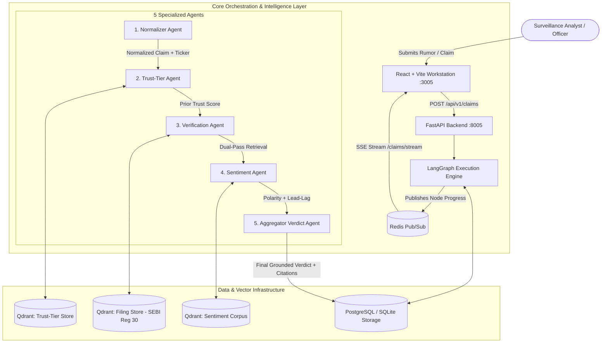
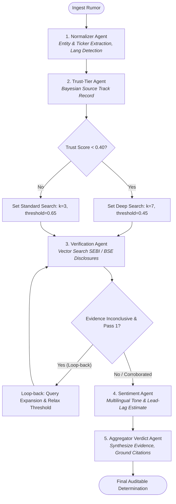

# MarketVerify — Multi-Agent Retrieval-Grounded Indian Market Rumor Verification Platform

[](https://python.org)
[](https://fastapi.tiangolo.com)
[](https://langchain-ai.github.io/langgraph/)
[-DC2626.svg?logo=qdrant&logoColor=white)](https://qdrant.tech)
[](https://react.dev)
[-success.svg)](backend/tests)
[](LICENSE)

> **MarketVerify** is an institutional surveillance and truth-grounding platform for listed Indian equities (BSE / NSE). It ingests unverified market rumors and social leaks in **English** and **Tamil (தமிழ்)**, orchestrates a **5-Agent LangGraph DAG**, and cross-references **SEBI LODR Regulation 30 corporate disclosures**, **Bayesian source track records**, and **price lead-lag dynamics** to issue definitive, auditable regulatory determinations.

---

## 📑 Table of Contents

- [Executive Summary & Problem Statement](#-executive-summary--problem-statement)
- [System Architecture & Data Flow](#-system-architecture--data-flow)
- [LangGraph 5-Agent Pipeline & Conditional Routing](#-langgraph-5-agent-pipeline--conditional-routing)
- [The 3 Isolated Qdrant Vector Stores](#-the-3-isolated-qdrant-vector-stores)
- [Multilingual & Bayesian Intelligence](#-multilingual--bayesian-intelligence)
- [Frontend Surveillance Workstation](#-frontend-surveillance-workstation)
- [Role-Based Access Control (RBAC) & Security](#-role-based-access-control-rbac--security)
- [API Reference](#-api-reference)
- [Test Suite & Quality Assurance](#-test-suite--quality-assurance)
- [Installation & Quickstart Guide](#-installation--quickstart-guide)
- [Production Roadmap & Scalability](#-production-roadmap--scalability)

---

## 🏛️ Executive Summary & Problem Statement

### The Problem in Indian Equities
In Indian financial markets, unverified rumors—circulated via Telegram channels, WhatsApp groups, FinTwit, and regional media—frequently induce 3% to 7% price swings before listed issuers publish formal clarifications to exchanges. Traditional market sentiment tools merely calculate text polarity without verifying whether the underlying rumor is factually true or an orchestrated market manipulation scheme.

### The MarketVerify Solution
MarketVerify solves this by replacing single-prompt LLM hallucinations with an asynchronous, deterministic **multi-agent RAG workflow**:
1. **Never guesses without evidence**: Every corroborated or contradicted verdict requires matching regulatory disclosure citations with cosine similarity scores and document URLs.
2. **Quantifies source credibility**: Applies a Bayesian Beta distribution prior ($\alpha=2, \beta=2$) to discount claims from serial leak channels and elevate credible whistleblowers.
3. **Adaptive retrieval depth**: Dynamically expands retrieval scope ($k=3 \to k=7$) and triggers automated query reformulation loops when early evidence is inconclusive.
4. **Multilingual support**: Native parsing and entity extraction for both English and regional Indian languages (Tamil).

---

## 📐 System Architecture & Data Flow



---

## 🤖 LangGraph 5-Agent Pipeline & Conditional Routing

The core verification workflow is constructed with **LangGraph** as a stateful, directed acyclic graph (DAG) with two critical conditional feedback loops.



### Agent Breakdown

| Agent | Identifier | Role & Decision Logic | Output Schema |
| :--- | :--- | :--- | :--- |
| **Normalizer Agent** | `INGEST_01` | Strips hype punctuation, normalizes company entity aliases (e.g. "RIL" $\to$ `$RELIANCE`), and detects source language (`en` / `ta`). | `normalized_text`, `ticker`, `language` |
| **Trust-Tier Agent** | `TRUST_02` | Queries author history, builds Beta-Binomial prior ($\frac{\text{accurate} + 2}{\text{total} + 4}$), flags serial pump-and-dump sources. | `trust_score`, `trust_rationale`, `confidence_level` |
| **Verification Agent** | `VERIFY_03` | Executes cosine similarity search over official SEBI disclosures; triggers query reformulation if similarity $< 0.50$. | `retrieved_evidence`, `similarity_score`, `loopback_count` |
| **Sentiment Agent** | `SENT_04` | Analyzes market sentiment polarity and estimates price lead-lag duration based on historical corporate event patterns. | `sentiment` (`POSITIVE`, `NEGATIVE`, `NEUTRAL`), `lead_lag_note` |
| **Aggregator Verdict Agent** | `VERDICT_05` | Resolves conflicting signals, attaches verifiable regulatory citations, and outputs the final compliance determination. | `VerdictResponse` with citations, confidence, explanation |

### Verdict Classifications
1. `CORROBORATED_OFFICIAL`: Grounded by matching exchange disclosure or board meeting resolution.
2. `CONTRADICTED_BY_FILING`: Refuted by official clarification under SEBI LODR Regulation 30.
3. `UNVERIFIED_RUMOR`: No official corroboration located in regulatory filings.
4. `LIKELY_CREDIBLE`: Corroborating signals from high-trust sources ($>0.80$) pending formal exchange publication.
5. `NO_EVIDENCE_FOUND`: Exhaustive multi-pass retrieval yielded no matching disclosures.

---

## 🗄️ The 3 Isolated Qdrant Vector Stores

Unlike naive single-collection vector setups, MarketVerify maintains three strictly isolated Qdrant vector collections to guarantee zero vector pollution across distinct semantic domains:

```
┌────────────────────────────────────────────────────────────────────────┐
│                   QDRANT ISOLATED COLLECTION TOPOLOGY                  │
├──────────────────────────┬──────────────────────┬──────────────────────┤
│ 1. trust_tier_store      │ 2. filing_store      │ 3. sentiment_corpus  │
├──────────────────────────┼──────────────────────┼──────────────────────┤
│ Author/channel track     │ Official SEBI / BSE  │ Multilingual news    │
│ records, historical      │ disclosures, board   │ headlines, market    │
│ confirmations, outcomes. │ outcome PDFs, LODR.  │ commentary, sentiment│
└──────────────────────────┴──────────────────────┴──────────────────────┘
```

---

## 🌐 Multilingual & Bayesian Intelligence

### 1. Bayesian Credibility Prior
To avoid overconfidence when evaluating sources with few observations, MarketVerify employs a Bayesian estimator with prior parameters $\alpha=2, \beta=2$:

$$\text{Trust Score} = \frac{\text{Confirmed Accurate Claims} + 2}{\text{Total Claims Evaluated} + 4}$$

- An unknown source with 0 claims receives an uninformative prior of $0.50$.
- A source with $3/3$ accurate claims is calibrated to $0.714$ (not $1.0$).
- A source with $0/3$ accurate claims is calibrated to $0.286$ (triggering deep search).

### 2. Native Tamil (தமிழ்) NLP Pipeline
Indian regional language market rumor channels (especially in southern retail hubs) frequently leak corporate developments in Tamil script. MarketVerify natively ingests, normalizes, and embeds Tamil text (e.g. *டாடா ஸ்டீல் காலாண்டு முடிவுகள்* $\to$ `$TATASTEEL`), mapping regional phrasing directly to official English exchange filings.

---

## 🖥️ Frontend Surveillance Workstation

The frontend is a **full-screen surveillance terminal** styled with institutional credibility (NSE / SEBI / RBI aesthetic):

- **Welcome & Overview (`/`)**: Front-door landing page with dynamic, animated 5-agent trace simulation, trust strip, and interactive methodology walkthrough.
- **Verification Terminal (`/verify`)**: Dual-column workspace for rapid claim submission, pre-loaded demonstration scenarios, and language selector.
- **Claims Register (`/claims`)**: Real-time surveillance ledger with aggregate metric cards (Corroborated, Contradicted, Unverified ratios) and searchable pagination.
- **Live Multi-Agent Trace (`/trace/:claimId`)**: Real-time visualization of the LangGraph DAG with live Server-Sent Events (SSE), step-by-step latency counters, and final determination payoff card with citations.
- **Source Credibility Docket (`/sources`)**: Bayesian accuracy gauges, historical trajectory timelines, and author track records.
- **Raw Data Explorer (`/data-explorer`)**: Raw PostgreSQL table views and Qdrant vector point inspection with JSON viewer (guarded for Admins & Auditors).

---

## 🔐 Role-Based Access Control (RBAC) & Security

The platform enforces 4 distinct institutional roles:

```
┌───────────────────────────────┬────────────────────────────────────────────────────────┐
│ Role                          │ Permissions & Scope                                    │
├───────────────────────────────┼────────────────────────────────────────────────────────┤
│ ANALYST                       │ Submit claims, inspect live agent traces, view ledger  │
│ COMPLIANCE_OFFICER            │ Analyst access + Source credibility oversight docket   │
│ ADMINISTRATOR                 │ Full access + Raw Data Explorer (Postgres & Qdrant)    │
│ AUDITOR                       │ Read-only inspection of verdicts, traces, and stores   │
└───────────────────────────────┴────────────────────────────────────────────────────────┘
```

- **Authentication**: Signed JWT Bearer tokens (`HS256`) with configurable expiration.
- **Password Security**: Passwords hashed with `bcrypt` (work factor 12).
- **Credentials Protection**: No plaintext passwords committed in git or sent to the browser.

---

## 🔌 API Reference

### Core Verification Endpoints
- `POST /api/v1/claims` — Submit claim and execute LangGraph multi-agent verification pipeline.
- `GET /api/v1/claims` — Fetch paginated list of claims with summary statistics.
- `GET /api/v1/claims/{id}` — Get full claim dossier with verdict and execution trace logs.
- `GET /api/v1/claims/stream/{id}` — Live Server-Sent Events (SSE) streaming of agent execution steps.

### Intelligence & Source Endpoints
- `GET /api/v1/sources/{handle}/trust-history` — Retrieve Bayesian track record and past claim outcomes.

### Surveillance Auditing & Data Explorer
- `GET /api/v1/admin/data/claims` — Raw claims table dump (Admin/Auditor only).
- `GET /api/v1/admin/data/agent-runs` — Full execution trace snapshots.
- `GET /api/v1/admin/data/users` — User registry (never returns password hashes).
- `GET /api/v1/admin/data/trust-tier-docs` — Raw points in Qdrant trust-tier collection.
- `GET /api/v1/admin/data/filing-docs` — Raw points in Qdrant filings collection.
- `GET /api/v1/admin/data/sentiment-docs` — Raw points in Qdrant sentiment collection.

---

## 🧪 Test Suite & Quality Assurance

MarketVerify includes an end-to-end automated test suite covering unit agent logic, graph routing branches, API authorization, and role security:

```bash
pytest backend/tests -v
```

### Test Coverage Highlights
- ✅ `test_aggregator_corroborated_verdict` — Verification of citation synthesis.
- ✅ `test_routing_after_trust_low_score_triggers_deep_retrieval` — Conditional branch validation ($k=7$).
- ✅ `test_routing_after_verification_inconclusive_first_pass_loops_back` — Query expansion retry loop.
- ✅ `test_post_tamil_claim` — Regional Tamil claim normalization and ticker extraction.
- ✅ `test_login_success_and_jwt_claims` — JWT claims, expiration, and password hashing.
- ✅ `test_role_guarded_admin_data_access` — HTTP 403 enforcement for unauthorized roles.
- ✅ `test_users_endpoint_never_exposes_password_hash` — Security assertion on user endpoints.

**Result: 30 / 30 Passed (100% test suite pass rate)**

---

## 🚀 Installation & Quickstart Guide

### Prerequisites
- Python 3.11+
- Node.js 18+ and npm
- (Optional) Docker & Docker Compose

### 1. Clone the Repository
```bash
git clone https://github.com/AnusreeThanapal/MarketVerify.git
cd MarketVerify
```

### 2. Backend Setup
```bash
# Create and activate virtual environment
python -m venv .venv
source .venv/bin/activate  # On Windows: .venv\Scripts\activate

# Install dependencies
pip install -r backend/requirements.txt

# Run idempotent database migrations & demo data seed
python backend/scripts/seed_demo_users.py
python backend/ingestion/run_all_ingestions.py

# Start FastAPI server on port 8005
python -m uvicorn backend.app.main:app --host 127.0.0.1 --port 8005 --reload
```

### 3. Frontend Setup
```bash
cd frontend
npm install
npm run dev
```

### 4. Access the Platform
- **Workstation Portal**: [http://localhost:3005](http://localhost:3005)
- **Interactive Swagger Docs**: [http://localhost:8005/docs](http://localhost:8005/docs)
- **1-Click Demo Login**: Use the pre-configured role buttons on the Sign In page.

---

## 🔮 Production Roadmap & Scalability

1. **Direct Exchange Feed Ingestion**: Connect real-time websockets to BSE BSE-SME and NSE NEAPS RSS feeds for sub-second filing indexing.
2. **Vision-Language PDF Parser**: Ingest scanned Indian corporate PDF balance sheets and annexures via ColPali multimodal embeddings.
3. **Automated Regulatory Rebuttal Drafts**: Generate standardized SEBI Regulation 30 clarification letter drafts for compliance officers to dispatch to exchange surveillance desks.
4. **Distributed Task Queue**: Scale multi-agent LangGraph executions across Celery workers backed by Redis clusters.

---

## 📄 License
This project is licensed under the MIT License — see the [LICENSE](LICENSE) file for details.
